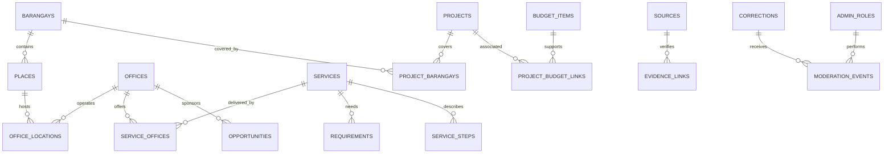
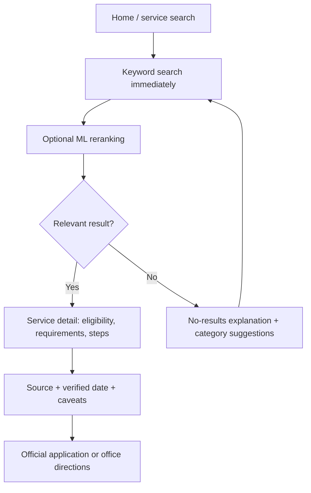
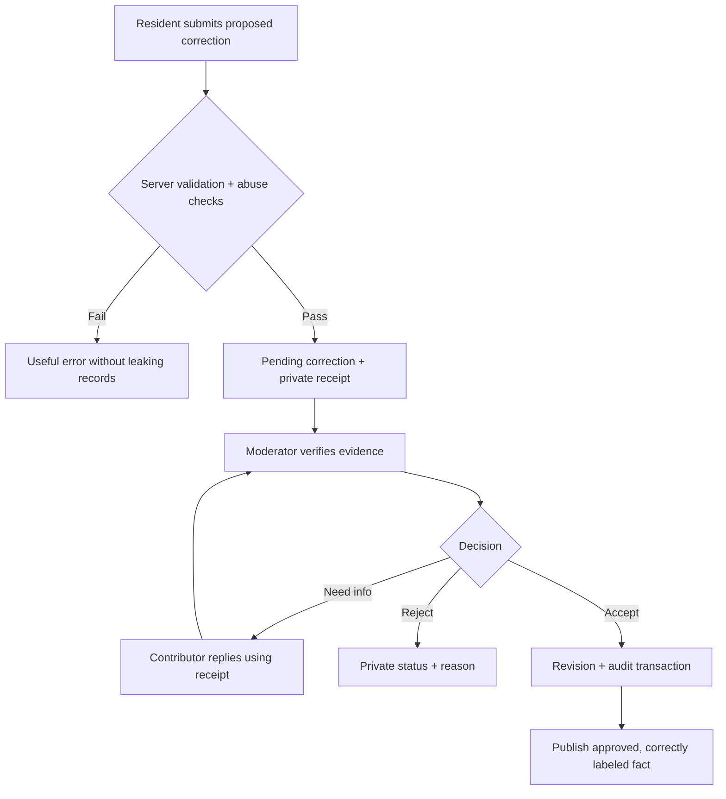
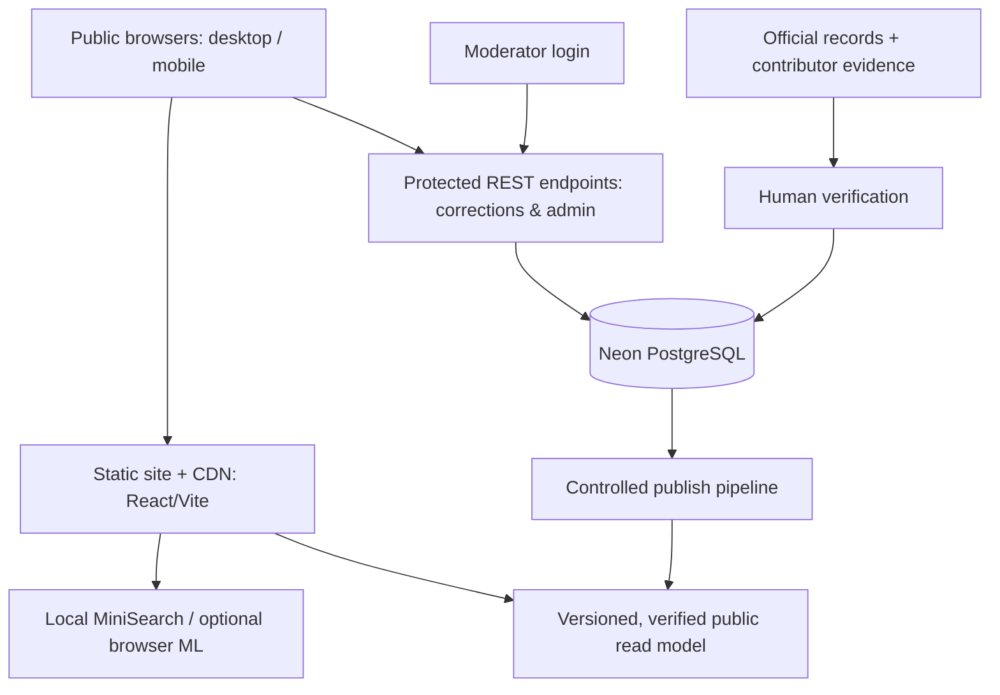

# BetterMuntinlupa — Product & Engineering Specification

> **Status:** Planning draft for review, not an implementation authorization  
> **Created:** 2026-11-18 (Asia/Manila)  
> **Target:** One public launch before 2027, subject to safety and launch gates  
> **Repository:** [AK-Lmn/muntara](https://github.com/AK-Lmn/muntara)  
> **Relationship to Muntara:** Proposed expansion/pivot; preserve and build upon existing code  
> **Ownership:** Independent community civic-tech project; **not** an official City Government of Muntinlupa service

This document consolidates the eight pre-implementation planning stages agreed in discussion. Distinguish **confirmed product requirements**, **proposed technical choices**, and **open decisions**. It deliberately does not claim that infrastructure, features, tests, data imports, or integrations have been implemented.

---

## 0. Executive summary and decision record

**Mission:** Help Muntinlupa residents quickly find understandable, current, source-backed public service information, local government facilities, laws, and financial records, while enabling safely moderated community corrections.

**Core audience:** Residents (including seniors, PWDs, students and workers), visitors, civic researchers, contributors, and volunteer moderators.

**Confirmed constraints**

| Dimension | Decision |
|---|---|
| Team | Solo maintainer initially, with community contributions |
| Budget | Strictly free where practical; small justified recurring costs acceptable |
| Deadline | Aim to launch by 2026-12-31; never waive security/truthfulness requirements to hit date |
| Capacity | Design for citywide public use; actual concurrency and budget must be measured |
| Client | Responsive desktop-quality and mobile-friendly web application |
| Offline | **Not required** for initial public launch; clearly handle unavailable connectivity |
| AI | ML-based semantic retrieval permitted; **no chatbot or generated civic instructions** |
| Release | **One public launch** after feature and quality gates; slices are private internal milestones |
| Contribution | Public anonymous corrections; human moderation; maintainer accountable for verification |
| Auth | Public reading without accounts; access-controlled moderator/admin accounts only |
| Trust | Cite sources and dates; unknown, stale, or disputed facts are labeled |
| Starting point | Reuse Muntara rather than replace it with a framework rewrite |

**Decisions not yet finalized:** Hosting and compute quotas under real citywide traffic; Neon-specific auth implementation; exact public-data publication workflow; tile provider; ML embedding model; detailed coverage inventory; operating budget ceiling; domain and legal attribution review.

**Non-goals:** Official government transaction processing, online fees/payments, claims of official affiliation, turn-by-turn navigation, community social network, public user account system, open-ended generative civic answers, complete automatic extraction of every public PDF, and offline-first operation.

## 1. Problem, outcome and success

### 1.1 Problem

Government information is fragmented across municipal webpages, uploaded PDFs, barangay announcements and agency directories. Residents may not know which office handles a request, what documents are needed, whether a contact number is current, what a financial amount represents, or where a facility actually is.

### 1.2 User jobs-to-be-done

1. **Service seeker:** “How do I apply for a scholarship / certificate / permit?” → Find correct eligibility, requirements, steps and authoritative link.
2. **Facility seeker:** “Where is the health center / barangay office?” → Find address, phone, map and plainly stated confidence.
3. **Civic reader:** “What happened to this budget or project?” → See primary documents and distinguish proposal, approval and spending.
4. **Contributor:** “This number or location is wrong.” → Report it anonymously and track a human decision.
5. **Moderator:** Verify evidence, resolve reports, update published facts and leave an audit trail.

### 1.3 Definition of done

A person can accomplish the applicable job without signing in or guessing whether information is verified; published records have accessible evidence and freshness metadata; corrections persist and are controlled; nine barangays are represented with transparent coverage gaps; the platform is secure, usable and operable by its maintainer.

“Citywide” means access and coverage structure across all nine barangays; it does **not** imply exhaustive, perfectly current enumeration of every agency, service or public project.

### 1.4 Success indicators — provisional, to validate

- At least **20** high-demand, genuinely sourced service guides at launch, adjusted after source-inventory review.
- All nine barangays have dedicated pages and an explicit coverage status.
- At least **90%** top-3 relevance on a manually judged test set of **60+** Filipino, Taglish and English queries.
- No fabricated addresses, contacts, requirements, financial amounts or verification claims.
- All critical workflows pass repeatable end-to-end tests.
- No unresolved critical security findings; restores and incident procedures demonstrated.

## 2. Functional scope and prioritization

### 2.1 Launch-critical capabilities

| Area | Resident-facing capability | Trust / operations requirement |
|---|---|---|
| Government service finder | Search categories and high-demand service guides; eligibility, requirements, steps, fees if sourced, office, official action link | Source per material claim, last checked date, no unsupported advice |
| Barangay explorer | Nine barangay pages: Alabang, Ayala Alabang, Bayanan, Buli, Cupang, Poblacion, Putatan, Sucat, Tunasan | Coverage indicators; boundaries and geography attribution |
| Public place/office directory | Government offices, public clinics, public schools, maps, hours and official contacts when known | No fabricated coordinates or accessibility details |
| Emergency information | Clearly presented official emergency contacts and service location links | Highest verification priority; mark source and recheck date |
| Legislation and records | Search, filter and link original ordinances, resolutions and executive orders | Correct document number, category, enactment/approval date |
| Transparency | Budgets, financial disclosure documents and public-project records with filters | Distinguish **proposed / approved / obligated / disbursed** amounts and source period |
| Opportunities | Scholarships, training and public-sector opportunities when verifiable | Explicit opening, deadline and expired/unknown status |
| Hybrid search | Immediate keyword search plus optional semantic reranking of **curated records** | No invented answer; graceful keyword-only fallback |
| Community corrections | Anonymous submission, private tracking receipt, status and reply | Server-side validation, abuse limits and privacy |
| Moderator workspace | Authentication, evidence review, accept/reject/request info/reopen, publication workflow | Authorized actions, transactionality and immutable audit events |
| Site fundamentals | Responsive navigation, accessible states, contact/disclaimer/about and source policy | Monitoring, error handling, backups, recovery, maintainership |

### 2.2 Explicitly deferred

Native mobile applications; payments; public accounts/profiles; chatbots; predictive analytics; automated approval of crowdsourced facts; unrestricted PDF scraping; livestreamed city operations; complex GIS navigation; full offline sync; a general-purpose multi-city platform.

### 2.3 Key public content principles

- Publish verified facts, not automated conclusions or advocacy claims.
- Use **“not confirmed”** or **“not found in available records”** rather than guessing.
- Show authoritative links prominently; external government systems remain responsible for transactions.
- Avoid implying the project is an official government portal.
- Financial data is historical and stage-specific; do not call a proposal an expenditure.
- Contributor acceptance is not automatically physical or official verification.

## 3. Existing Muntara baseline — source code audit

The present repository has:

- React 19, TypeScript, Vite 8, Tailwind 4, React Router 7, Leaflet and `@supabase/supabase-js`.
- Routes presently exposed in `src/App.tsx`: `/`, `/places/:placeId`, `/corrections/new`, `/corrections`.
- `src/pages/ExplorePage.tsx`, `PlaceDetailPage.tsx`, correction pages, design-system components and a Leaflet map.
- `src/data/pilotPlaces.ts` loading a bundled sourced pilot dataset.
- `src/lib/placeApi.ts` optionally reading Supabase; if public Supabase environment variables are absent, falling back to bundled pilot data.
- `src/lib/mockApi.ts` providing **in-memory** corrections and moderation logic; corrections do not persist across reloads.
- `supabase/migrations/20261026174827_places_and_sources.sql` defining places, field-level sources and Supabase RLS. It currently constrains `barangay` to **Tunasan/Poblacion**, and database `category` to three categories; TypeScript and pilot content support broader values.
- An earlier pilot design at `docs/superpowers/specs/2026-10-27-muntinlupa-public-services-pilot-design.md`.
- A stale root `README.md` describing an older mock-only state. Reconcile it at implementation time, not in this documentation-only commit.

**Migration rule:** Preserve prior history and original database migrations. Create new additive migrations; reconcile existing data and semantics explicitly. Do not treat Supabase RLS, roles, auth or browser client as portable to Neon without rewrites and tests.

**Repository transition:** Decide at implementation kickoff whether to rename the repository to BetterMuntinlupa. First preserve a pre-pivot Git tag/branch. No repository rename or branch rewrite is authorized by this planning document.

## 4. Domain model first

The following is a **logical schema proposal**, not committed DDL. Normalize high-value domain relationships; keep versioned static read models for public browsing if useful.

### 4.1 Proposed entities and key fields

| Table | Representative fields and constraints |
|---|---|
| `barangays` | `id`, unique `psgc_code` (where validated), unique slug, official name, coverage metadata |
| `places` | UUID, `barangay_id` FK, category, address, nullable lat/lng, published state, confidence, timestamps |
| `offices` | UUID, official name, parent agency, published public contact, verification |
| `office_locations` | `office_id` + `place_id` relationship; optional service-desk notes |
| `services` | UUID, unique slug, category, eligibility text, fees and caveats, official action URL, source status |
| `service_offices` | `service_id`, `office_id`, availability/channel and notes |
| `requirements` | `service_id`, order, requirement text, applicability, source evidence |
| `service_steps` | `service_id`, step number, instruction, source evidence |
| `opportunities` | Program title, type (scholarship/training/job), office, opening/closing dates, URL, availability |
| `documents` | Document type, document number, title, approval/publication dates, official URL, fiscal context |
| `projects` | Official project identifier, title, agency, status, dates, description, verified location when known |
| `project_barangays` | Many-to-many coverage; avoids forcing multi-barangay projects into one barangay |
| `budget_items` | Fiscal year, period, amount `NUMERIC(18,2)`, currency PHP, `financial_stage`, document/source |
| `project_budget_links` | Explicit sourced relationship between project and financial entry; not inferred |
| `sources` | Source URL/citation, publisher, class, fetched/checked date, license/reuse notes |
| `evidence_links` | Source ID, validated target entity + target field, evidence text/location, verification method |
| `corrections` | Target entity/field, proposal, status, receipt token **hash**, moderation-safe metadata |
| `moderation_events` | Correction, action, authorized actor, reason, timestamp; append-only |
| `admin_roles` | Authenticated user subject, role, authorization metadata; no self-escalation |
| `record_revisions` | Target, previous/new values or diff, actor, reason/source, created timestamp |

Entity-specific FK junctions may be preferable to polymorphic `entity_type`/`entity_id` links where database-enforced referential integrity is critical. Finalize before writing DDL. Search embeddings and publish snapshots are **derived artifacts**, never authoritative facts.

### 4.2 Integrity and privacy rules

1. UUID identities; stable unique slugs for public routes; preserve original source keys when importing Muntara data.
2. All nine barangays with verified canonical spellings/codes. Nullable coordinates must be a pair.
3. Use `NUMERIC(18,2)` for PHP; record fiscal year, amount scope and stage independently. Never combine proposed and actual totals.
4. Published civic records require source evidence appropriate to their material claims.
5. Distinguish **source checked**, **human field-checked**, **community-reported**, **stale**, **disputed** and **unknown** states.
6. Link source evidence to individual fields where practical; site-wide “verified” labels may mislead when one attribute changed.
7. Drafts, moderation notes, receipt hashes and contact-related private data must not enter public JSON/CDN/search indexes.
8. Contributor receipt codes: cryptographically random and unguessable, show to the user once, hash server-side, support scoped status lookup/reply; no report enumeration.
9. Only authorized moderators can approve changes. Acceptance writes revision + moderation event atomically; evidence determines verification state.
10. Never use client-provided display names, metadata or role claims as authorization.

### 4.3 Proposed indexes and access patterns

- `places(barangay_id, publication_state, category)`, unique place slug/source key.
- `services(slug)` unique; relationships indexed by service and office.
- `documents(document_type, approved_date)` and document number where defined.
- `budget_items(fiscal_year, financial_stage)`, `projects` by official identifier and status.
- `corrections(status, created_at)`; moderation events by correction ID and timestamp.
- `evidence_links` indexed by target and source; relationship indexes on all FKs.
- Public search index generated from **published** data only; verify output excludes draft/private fields.

## 5. User journeys and experience design

### 5.1 Search → official service guidance

**Done:** Resident knows what to prepare and where to act. Never perform an official application on their behalf.

### 5.2 Barangay → location

Choose barangay → filter office/clinic/school → list or map → place details → address, public contacts and accessibility where sourced → official directions link. Missing coordinates stay missing; no fake pin.

### 5.3 Transparency → source document

Choose budgets/projects/legislation → filter year, barangay, type → readable entry → explicit fiscal stage/status → primary-source document/PDF. If records are unavailable, show a coverage statement rather than zero-spending claims.

### 5.4 Contribution → human review

**Done:** A report is traceable, human-reviewed and safely resolved.

### 5.5 Wireframe/navigation principles

- Desktop: real top navigation, large search, service/record entry points, list-and-map layouts, source badges.
- Mobile: compact responsive navigation, large tap targets and readable text; **not** a native-app-only layout.
- Main IA: Home/Search · Services · Explore · Government · Legislation · Transparency · Opportunities · Emergency · About/Sources · Correction Tracking. Protected Admin separate.
- All flows: loading skeleton/status; empty; network/API error; unverified/stale; unauthorized; rate-limited; no-search-model fallback.
- Map never replaces an accessible list. Avoid color-only verification signaling.

## 6. Architecture decision records (proposed)

**Important:** Static read models must be generated/released through one auditable publishing process. Avoid independently editing DB records and JSON without reconciliation; document the canonical write/publish path during the spike.

| ADR | Choice | Why | Cost / risk |
|---|---|---|---|
| 001 | Modular monolith, one repo | Small solo-maintained system | Modules must remain well-separated |
| 002 | Preserve React/Vite/Tailwind/Router/Leaflet | Existing Muntara investment | SEO/indexability may require prerendering |
| 003 | Static-first sourced public content | Cheap fast citywide reads; usable during DB outage | Publication invalidation and freshness process required |
| 004 | **Neon PostgreSQL preferred**, not yet provisioned | Free-first capacity and branching; PostgreSQL compatible | Supabase SDK/RLS/auth are **not** portable directly |
| 005 | Server REST endpoints for privileged writes | Restrict DB secrets and validate anonymous submissions | Runtime quotas; abuse protection |
| 006 | Evaluate Neon Managed Better Auth for moderators | Avoid building auth from scratch | Must validate roles, session security and provider limits |
| 007 | MiniSearch + optional Transformers.js multilingual embeddings | Taglish search without remote LLM fees | Download, CPU/RAM, mobile UX |
| 008 | Leaflet + suitable licensed tiles | Reuse map; no invented coordinates | Third-party tile limits and attribution |
| 009 | GitHub CI + protected Vercel preview | Repeatable tests and one controlled public release | Hosting terms/limits must be checked before launch |

Provider free plans change. **Revalidate current quota, commercial/non-commercial terms, payment requirements, regions, observability and backup provisions before provisioning.** If Vercel Hobby terms conflict with eventual operating use, select an eligible hosting arrangement instead of assuming it is free.

### Architecture security boundary

- No raw Neon database credentials or moderator secrets in `VITE_*` variables or browser bundles.
- Server-side auth and authorization for every admin operation, not only route hiding.
- Parameterized SQL, typed input validation, strict response shapes, CSRF protection for cookie-authenticated writes, rate limits and anti-spam checks.
- Static/CDN response contains only approved public content.
- Confidential contributor material stays in protected storage and is excluded from logs/analytics.
- Separate dev/test/production credentials, databases/branches and deployment environment controls.

## 7. Risk register and throwaway validation spikes

**These are planned experiments, not executed tests. Do not provision a project or modify production until implementation authorization.**

| Risk | Proposed experiment | Pass condition | Fallback |
|---|---|---|---|
| Supabase → Neon | Disposable branch with adapted places, source, correction models | Imports, constraints, rollback and role security work | Redesign server API or alternate managed Postgres |
| Moderator auth | Protect one temporary admin endpoint using candidate auth | Unauthorized/session-forged/role-escalated calls denied | Independent battle-tested auth service |
| Anonymous reports | Submit, private receipt lookup, reply, moderation, audit with transaction | Cross-report access impossible; persistence and rollback proven | Reduce reporting surface until secured |
| Official data availability | Inventory sample service, location, ordinance, disclosure sources and reuse permissions | Enough accurate primary sources for launch-critical sections | Publish explicit coverage gaps, narrow counts |
| Semantic search | 60+ curated English/Filipino/Taglish queries; compare keyword vs hybrid | Top-3 ≥90% and measurable gain; acceptable mobile performance | Keyword/synonym search only until model passes |
| Browser model | Cold/warm load, RAM, responsiveness on budget Android | Keyword results immediate, ML doesn't block UI | Deferred inference or smaller model |
| Map hosting | Test provider limits, attribution, load and failure | Legal tile usage and acceptable response for planned load | List-first mode or approved commercial tiles |
| Citywide traffic | Exercise CDN public traffic and simulated limited API bursts | Meets agreed latency/errors and known free-tier quotas | Rate limits, cache, paid upgrade if justified |
| Discoverability | Test indexability of service detail pages | Important pages discoverable without JS rendering failures | Prerender selected public routes |

**Risk order:** Source-data feasibility and secure persistence/auth are highest risk. Test ML/maps before relying on their optional behavior. No production mutation required to design these tests.

## 8. Internal vertical-slice sequence

**Slices are internal implementation milestones only. There is no public V1/V2/MVP rollout.** Each slice includes data, UI, API if needed, tests, source evidence and accessible error/empty states.

| Slice | Outcome and acceptance |
|---|---|
| 1. Foundation and migration | Stable types/schemas, all barangays, source/read model, responsive shell; no fabricated data or broken legacy reads |
| 2. Service finder | Search a real sourced service, read eligibility/steps, follow correct official link; tests for no-results/stale |
| 3. Explore and emergency | Browse nine barangays, list/map verified places, clearly see unknowns, find sourced emergency contacts |
| 4. Transparency and civic documents | Browse original documents, budgets and projects with stage/period/coverage accuracy |
| 5. Community and moderation | Anonymous persistent report → secure receipt → authorized review → revision → publication with audit |
| 6. ML-enhanced retrieval | Improves multilingual intent search and falls back cleanly without model |
| 7. Hardening and launch review | Full performance, privacy, security, accessibility, ops/data audit and go/no-go |

**Approximate target calendar, subject to capacity:** Nov 18–24 foundation; Nov 25–Dec 1 service finder; Dec 2–8 explorer; Dec 9–15 transparency; Dec 16–22 corrections/ML; Dec 23–31 validation. This is aggressive for a solo developer. Research, data sourcing, security and testing **run throughout**, not only in the final week. Deadline is subordinate to safety.

**Definition of done for each internal slice:** Real or explicitly marked fixture data; working end-to-end behavior; automated tests; responsive/accessible loading/empty/error states; permission checks; source attribution; documented migration/rollback as relevant.

## 9. Quality engineering and release gates

### 9.1 Test pyramid

| Level | Candidate tools | Scope |
|---|---|---|
| Unit | Vitest | Validators, trust states, fiscal calculations, search ranking |
| UI/component | React Testing Library | Filters, labels, error states, accessibility semantics |
| DB/API integration | Test Neon branch + HTTP test harness | SQL constraints, access boundaries, receipt hashes, atomic moderation |
| End-to-end | Playwright | Service search, map/list, documents, corrections, admin |
| Accessibility | axe-core + manual keyboard/screen-reader | Target WCAG 2.2 AA |
| Security | OWASP ASVS-based review and negative tests | AuthZ, injection, session/CSRF, privacy and abuse |
| Performance | Lighthouse/Core Web Vitals + load scripts | Low-end Android, cold cache, citywide spike scenarios |
| Data QA | Provenance audit + reconciliation scripts | No missing evidence, wrong fiscal stage or invented coordinates |

### 9.2 Proposed performance targets

- LCP ≤ 2.5 seconds, INP ≤ 200 ms, CLS ≤ 0.1 at the 75th percentile once meaningful field data exist; synthetic lab tests during development.
- Budget Android phone, throttled network and cold/warm cache tests.
- Public search usable without downloaded ML model; map does not block access to list.
- Test provisional 100 and 500 concurrent browsing users and controlled bursts of submissions. These are **test loads**, not a claim that the hosting tier supports them.

### 9.3 Data freshness and verification schedule (provisional)

| Class | Review policy |
|---|---|
| Emergency numbers | Monthly and after a reported change, with urgent review of disputes |
| Government contacts/hours | Every 90 days or on official change |
| Service requirements/fees | Every 90 days or following official update |
| Opportunities | Deadline and closure checks near the indicated dates |
| Legislation | Check against original authoritative document |
| Budgets/projects | Preserve fiscal period, original documents, amendment history and stage |
| Community corrections | Human review before public change, maintain visible backlog |

A review interval is a **maintenance target**, not a warranty of current information. A stale service requirement may need suppression or explicit warning.

### 9.4 Operations and recovery

- External uptime checks, bounded error logs, API submission failure alerts, source-link monitoring and a published contact channel.
- Automated encrypted database backups **outside the primary provider**, with written retention and a tested restore. Provider point-in-time recovery is not a substitute for off-site backup.
- Versioned data publication with provenance, record revisions and simple rollback.
- Credential rotation and least-privilege access.
- Review deployment previews privately; run CI and E2E; release one reviewed production build.
- Record basic incident steps: detect, contain, disable submissions if required, restore/rollback, notify affected contributors where necessary, document root cause.

### 9.5 Launch gate — mandatory

- [ ] Nine barangays are represented; coverage/completeness limitations visible.
- [ ] Core service/office/emergency/legislation/transparency sections provide useful **real sourced information**.
- [ ] At least 20 verified high-demand service guides or a formally revised coverage target from the source audit.
- [ ] No fictional records, unsupported instructions, or false verification claims.
- [ ] Material public claims link to attributable evidence and last-checked date.
- [ ] Financial proposed/approved/obligated/disbursed amounts correctly distinguished.
- [ ] Core anonymous correction flow and moderator permissions tested end-to-end.
- [ ] No critical/high unresolved authorization, privacy or injection defects.
- [ ] Hybrid search evaluation passes or documented keyword-only fail-safe meets user needs.
- [ ] Keyboard, responsive, accessible empty/error states and core performance targets tested.
- [ ] Off-site backup restore, rollback, monitoring and incident runbook demonstrated.
- [ ] Domain/attribution/terms and independent-project disclaimer reviewed.
- [ ] Maintainer has realistic source update and moderation capacity.

**GO:** All mandatory gates met and evidence reviewed.  
**NO-GO:** Failed trust, safety, auth or recovery gates, even near December 31.

## 10. Governance, community and licensing

- Independent, community-led, publicly source-backed project. Never use official insignia or endorsement claims misleadingly.
- Contributors propose edits; they do **not** directly modify live civic records.
- Prefer official agency sites/documents and appropriately licensed open data; preserve source URLs, attribution, extraction dates, and license conditions.
- Verify each dataset's allowed use before mirroring PDFs, maps, images or structured listings.
- OpenStreetMap, if used, requires proper attribution; public OSM tiles are not an unrestricted high-volume CDN.
- Do not collect resident IDs, private medical details or personal numbers merely to support corrections; accept only necessary information.
- Decide repository content license and separate datasets/assets license before public contribution intake.
- Draft contributor guidelines, correction standards, moderation policy and privacy notice before launch.

## 11. Source inventory (starting points, not completeness guarantees)

**Official local sources**

- City Government of Muntinlupa: https://muntinlupacity.gov.ph/
- Barangays: https://muntinlupacity.gov.ph/barangays/
- Offices: https://muntinlupacity.gov.ph/departments-offices/
- Citizen's Charter: https://muntinlupacity.gov.ph/citizens-charter/
- Full Disclosure Board: https://muntinlupacity.gov.ph/full-disclosure-board/
- City GIS: https://cgis.muntinlupacity.gov.ph/
- City disaster resilience: https://ddrm.muntinlupacity.gov.ph/

**Potential civic/open-data references (evaluate current maintenance and licensing)**

- BetterLGU guide: https://lgu.bettergov.ph/guide
- BetterGovPH open datasets: https://data.bettergov.ph/
- BetterGovPH transparency portal: https://github.com/bettergovph/transparency-portal
- Better local government starter: https://github.com/iyanski/betterlocalgov
- Sibika civic directory: https://zai-exe.github.io/sibika/
- OpenStreetMap attribution and tile policy: https://operations.osmfoundation.org/policies/tiles/

**Technical references**

- Neon: https://neon.com/docs
- Vercel deployments: https://vercel.com/docs/deployments
- WCAG 2.2: https://www.w3.org/TR/WCAG22/
- OWASP ASVS: https://owasp.org/www-project-application-security-verification-standard/

**Source inventory task:** For each candidate, record maintainer, licensing, update frequency, field coverage, access method, reliability, and whether it supplies verified facts or only leads. National **proposed** budgets must never be presented as actual local expenditures.

## 12. Open questions / final pre-build sign-off

Resolve before implementation where the decision changes architecture:

1. **Publish pipeline:** Which is canonical for approved facts—database records with generated public snapshots, or reviewed version-controlled content with DB only for private workflow? Pick one conflict-free process.
2. **Moderation auth:** Validate current Neon auth offering, role mapping, MFA/session policy and server-side permissions.
3. **Funding:** Agree acceptable small monthly operating cap if free quotas/terms fail citywide testing.
4. **Source coverage:** Audit enough real services and original records to establish feasible release inventory; don't fabricate completeness.
5. **Map:** Choose licensed tiles with attribution and an outage fallback.
6. **ML:** Select multilingual model and benchmark on actual budget Android hardware; avoid huge bundle downloads.
7. **Monitoring/backup provider:** Ensure off-site restore and notification fit the budget.
8. **Legal/trust:** Agree privacy notice, license, content reuse/attribution policy and non-affiliation wording.
9. **Repository branding:** Decide when (if ever) to rename Muntara to BetterMuntinlupa.

### Implementation authorization boundary

This planning document **does not** authorize creating Neon projects, provisioning infrastructure, changing production deployment, modifying existing data, renaming repositories, or shipping public releases. Implementation starts only after review of this spec and an explicit build instruction.

---

## Appendix A. Planning-stage traceability

| Senior-engineering stage | Evidence in this document |
|---|---|
| 1. Problem before feature | `1` + `2` |
| 2. Constraints | `0` |
| 3. Data model | `3` + `4` |
| 4. User flows | `5` |
| 5. Architecture/ADRs | `6` |
| 6. De-risk | `7` |
| 7. Vertical slices | `8` |
| 8. Quality and operations | `9`–`10` |

**Overall status on 2026-11-18:** Planning documentation assembled. Technical decisions are provisional until explicitly validated. No BetterMuntinlupa feature or database implementation is implied.
